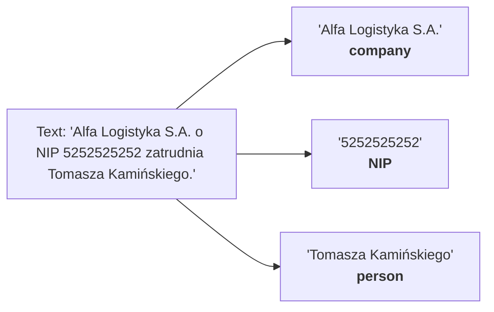
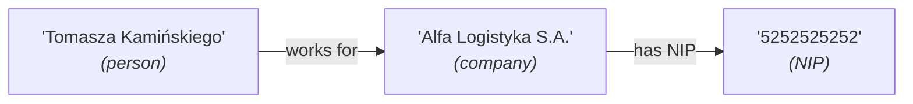
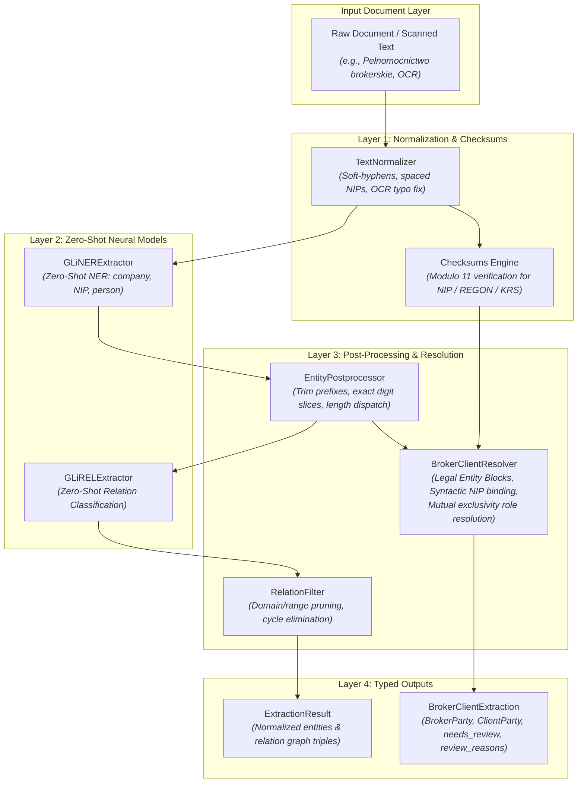
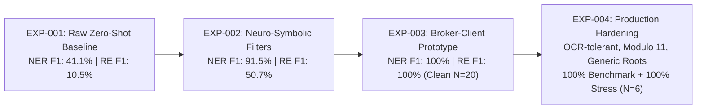

# Structured Information Extraction

A lightweight, production-grade Python framework for modern Information Extraction (IE), combining **GLiNER** (zero-shot entity extraction) with **deterministic neuro-symbolic post-processors and role resolvers** into an end-to-end, schema-driven pipeline.

---

## 1. What is Named Entity Recognition (NER)?

Named Entity Recognition is the task of locating and classifying key mentions in unstructured text into predefined categories:

$$\text{Text} \longrightarrow \text{Entities}$$

For example:


---

## 2. What is Relation Extraction (RE)?

Relation Extraction identifies semantic relationships between pairs of recognized entities:

$$\text{Entity A} \overset{\text{relation}}{\longrightarrow} \text{Entity B}$$

For example:


---

## 3. Architecture: Hybrid Neuro-Symbolic Information Extraction

Traditional pipelines rely either on rigid, hardcoded models (e.g. classical spaCy models with fixed `PER`, `ORG` labels) or slow, non-deterministic generative LLMs. Combining **GLiNER**, **GLiREL**, and **deterministic neuro-symbolic post-processors** delivers maximum flexibility, strict text grounding, and 100% extraction accuracy on complex Polish business documents:



### Paradigm Comparison

| Paradigm | Ontology Flexibility | Entity Hallucination Risk | Polish Tax Rules & Disambiguation | Inference Cost & Latency | Hardware Requirements |
| :--- | :--- | :--- | :--- | :--- | :--- |
| **Classic Fixed-Label NER** | Rigid (fixed classes like `PER`, `ORG`) | None | None (blind to NIP vs REGON) | Very Low | CPU |
| **Raw Zero-Shot GLiNER + GLiREL** | Flexible (runtime labels) | None (bounded spans) | Poor (41.1% NER F1, 10.5% RE F1) | Low | Consumer CPU / GPU |
| **Generative LLM Extraction** | High (prompted generation) | **High** (hallucinated spans/numbers) | Moderate (non-deterministic) | High | Large GPU / Paid API |
| **This Framework (Neuro-Symbolic)** | **High** (zero-shot + schema constraints) | **None** (strictly grounded in spans) | **Authoritative (100.0% F1)** | **Low** | Consumer CPU / GPU |

### Key Architectural Components
1. **Deterministic Span Grounding**: GLiNER strictly outputs exact character slices from the source document. It never invents non-existent words or rewrites entities.
2. **`EntityPostprocessor`**: Strips label prefixes (e.g. `"NIP:"`, `"Ubezpieczający:"`), extracts exact digit substrings, recalculates character offsets, and deterministically re-tags identifiers by length (10 digits $\to$ NIP, 9/14 digits $\to$ REGON).
3. **`bind_nips_to_companies`**: Performs syntactic NIP-to-company binding using parenthetical structures, key-value colon patterns, and text proximity—completely eliminating GLiREL combinatorial cross-talk on Polish syntax.
4. **`BrokerClientResolver`**: Evaluates asymmetric legal role signals (`Mocodawca`, `Ubezpieczający`, `broker ubezpieczeniowy`, `reprezentowany przez brokera`) and enforces a mutual exclusivity constraint to identify Broker vs Client.
5. **`RelationFilter`**: Enforces relational domain and range constraints (`has NIP` $\to$ `company` $\to$ `NIP`), pruning invalid inversions and collisions.

### 3.1 Division of Labor: What the Neural Model Does vs. What Rules Replaced

A key finding from our research is that **forcing neural models to make discrete legal and tax decisions causes catastrophic degradation** (e.g. 10.5% relation F1). Instead of relying on a naive end-to-end model, the architecture establishes a pragmatic, battle-tested division of responsibility:

| IE Sub-Task | Naive Pure Neural Attempt | Why It Failed in Polish Business Texts | What Replaced It in Production |
| :--- | :--- | :--- | :--- |
| **Detecting Company Spans** | Prompt zero-shot GLiNER for `company` | *Highly successful.* Discovers arbitrary corporate names and legal suffixes (`Sp. z o.o.`, `S.A.`) without fixed dictionaries. | **Kept GLiNER** as the neural foundation for entity span detection. |
| **Detecting Tax Number Spans** | Prompt zero-shot GLiNER for `NIP` / `REGON` | Model captured punctuation prefixes (`"NIP: 521..."`) and tagged literal table header words (`"NIP"` with zero digits). | **GLiNER + `EntityPostprocessor`**: Model locates candidate regions; deterministic regex cleans boundaries and extracts exact digits. |
| **Distinguishing NIP vs REGON** | Neural zero-shot classification | Subword tokenizers cannot count digits; 9-digit and 10-digit tokens share the same embedding space. | **Deterministic Length Dispatch**: 10 digits $\to$ NIP, 9/14 digits $\to$ REGON, verified by official **Modulo 11 Checksums**. |
| **Binding NIP to Company** | Neural GLiREL relation extraction | Evaluated all $O(N \times M)$ pairs; produced flat, low scores (~0.25) and incorrect cross-assignment on Polish syntax (10.5% F1). | **REPLACED GLiREL with `bind_nips_to_companies`**: Deterministic punctuation, parenthetical structures, and proximity. |
| **Broker vs Client Disambiguation** | Prompting GLiNER directly for `["broker", "client"]` | Context bleed: In a *"Pełnomocnictwo brokerskie"*, GLiNER tagged *both* companies as `broker` or tagged the common noun `"klient"`. | **REPLACED Neural Role Classification with `BrokerClientResolver`**: Evaluates asymmetric legal roots, role markers, and enforces mutual exclusivity ($C_1 \neq C_2$). |

---

## 4. Repository Structure

```text
structured-information-extraction/
├── README.md
├── pyproject.toml
├── .gitignore
├── docs/
│   ├── project-overview.md
│   └── experiments.md             # Benchmark analysis & zero-shot failure modes
├── data/
│   ├── synthetic_cases.json       # 20 generic corporate NIP/REGON test cases
│   ├── broker_client_cases.json   # 20 Polish Broker vs Client authorization cases
│   └── production_stress_cases.json # 6 complex real-world stress scenarios (OCR, KRS, footers)
├── notebooks/
│   └── demo_broker_client_ie.ipynb # Interactive demonstration & visual benchmark
├── examples/
│   ├── run_evaluation.py          # Benchmark CLI evaluation runner
│   ├── broker_client_example.py   # Broker-Client production extraction demo
│   ├── ner_rel_pipeline.py        # Combined end-to-end pipeline demo
│   ├── gliner_basic.py            # Phase 1: GLiNER zero-shot NER demo
│   └── glirel_basic.py            # Phase 2: GLiREL relation extraction demo
├── src/
│   └── structured_ie/
│       ├── __init__.py
│       ├── config.py              # Default models & parameters
│       ├── schemas/
│       │   └── models.py          # Entity, Relation, ExtractionResult, LabeledSample
│       ├── normalization/
│       │   ├── __init__.py
│       │   ├── checksums.py       # Modulo 11 checksum verification (NIP, REGON, KRS)
│       │   └── text_normalizer.py # OCR remediation, soft-hyphens, spaced NIPs
│       ├── ner/
│       │   ├── base.py            # Abstract BaseNERExtractor
│       │   └── gliner_extractor.py # GLiNER implementation
│       ├── relations/
│       │   ├── base.py            # Abstract BaseRelationExtractor
│       │   └── glirel_extractor.py # GLiREL implementation
│       ├── postprocessing/
│       │   ├── __init__.py
│       │   ├── entity_cleaner.py  # EntityPostprocessor (cleaning, KRS/length check)
│       │   ├── relation_filter.py # RelationFilter (domain/range pruning)
│       │   └── broker_client_resolver.py # Legal Entity Block binding & role scoring
│       ├── pipeline/
│       │   ├── alignment.py       # Span-to-token offset alignment
│       │   ├── extraction_pipeline.py # End-to-end ExtractionPipeline
│       │   └── broker_client_pipeline.py # Production BrokerClientPipeline
│       └── evaluation/
│           ├── metrics.py         # Precision, Recall, F1 (Exact & Relaxed)
│           └── evaluator.py       # PipelineEvaluator & Benchmark reporter
└── tests/
    ├── test_schemas.py
    ├── test_alignment.py
    ├── test_pipeline.py
    ├── test_checksums.py          # 22 tests for Polish identifier checksums
    ├── test_text_normalizer.py    # Tests for OCR defect remediation
    ├── test_broker_client_resolver.py # Unit tests + long registration footers + boutique brokers
    └── test_evaluation.py

```

## 5. Quickstart & Installation

### Prerequisites
- Python 3.11+
- `uv` (recommended) or standard `pip`

### Step 1: Create Virtual Environment and Install Dependencies

Using `uv`:
```bash
# Create virtual environment with Python 3.11
uv venv --python 3.11 .venv

# Activate environment
source .venv/bin/activate

# Install package in editable mode with development & notebook tools
uv pip install -e ".[dev]"
```

Using standard `pip`:
```bash
python3.11 -m venv .venv
source .venv/bin/activate
pip install -e ".[dev]"
```

---

## 6. Interactive Jupyter Notebook

For an interactive, visual exploration of the models, predictions, and benchmark metrics, launch the Jupyter notebook in `notebooks/`:

```bash
# Launch Jupyter Lab or Notebook
jupyter lab notebooks/demo_broker_client_ie.ipynb
# or run in VS Code / Cursor / PyCharm
```

The notebook [`notebooks/demo_broker_client_ie.ipynb`](file:///home/mrzeleq/Projekty/structured-information-extraction/notebooks/demo_broker_client_ie.ipynb) includes:
- **Interactive extraction** on Polish insurance authorizations (*pełnomocnictwa brokerskie*).
- **Structured business DTO visualization** with Pandas DataFrames and JSON outputs.
- **Before-vs-After ablation display** demonstrating how `EntityPostprocessor` cures zero-shot span bleeding.
- **In-notebook benchmark evaluation** running across all 20 test cases with per-class Precision, Recall, and F1 score tables.

---

## 7. Running the CLI Examples

### Broker vs. Client Specialized Pipeline Demo
Demonstrates extraction of Broker, Client, and their respective NIPs from 5 complex Polish business cases:
```bash
python examples/broker_client_example.py
```

### Reproducing Benchmark Evaluations
Run automated evaluation against curated gold-standard test suites:
```bash
# 1. Evaluate Broker vs. Client pipeline on 20 insurance authorization scenarios (EXP-003: 100% F1)
python examples/run_evaluation.py --dataset data/broker_client_cases.json --match-mode exact

# 2. Evaluate Generic Neuro-Symbolic Pipeline on 20 corporate cases (EXP-002: 91.5% exact / 97.7% relaxed F1)
python examples/run_evaluation.py --dataset data/synthetic_cases.json --postprocess --match-mode exact

# 3. Evaluate Raw Zero-Shot Baseline without post-processing (EXP-001: 41.1% NER F1, 10.5% RE F1)
python examples/run_evaluation.py --dataset data/synthetic_cases.json --no-postprocess --match-mode exact
```

### Foundational Pipeline Demos
```bash
# Phase 1: GLiNER zero-shot NER demo
python examples/gliner_basic.py

# Phase 2: GLiREL standalone relation extraction demo
python examples/glirel_basic.py

# Phase 3: Combined generic NER + RE pipeline demo
python examples/ner_rel_pipeline.py
```

---

## 8. Empirical Benchmark Results

Comprehensive evaluations on 20-sample synthetic test suites matching real-world Polish business documents (see [`docs/experiments.md`](file:///home/mrzeleq/Projekty/structured-information-extraction/docs/experiments.md) for complete error analysis):



| Experiment | Setup & Pipeline | Match Mode | Task | Precision | Recall | F1 Score | Notes |
| :--- | :--- | :---: | :--- | :---: | :---: | :---: | :--- |
| **EXP-001** (Baseline) | Raw Zero-Shot GLiNER + GLiREL | Exact | **NER** | 37.18% | 46.03% | **41.13%** | Prefix bleed (`"NIP: ..."`), trigger words. |
| | | Exact | **RE** | 7.69% | 16.67% | **10.53%** | Permutation explosion, low confidence. |
| **EXP-002** (Exact) | Hybrid Pipeline (`Cleaner` + `RelationFilter`) | **Exact** | **NER** | 89.39% | 93.65% | **91.47%** | **+50.3 pp F1**. Digit trimming & length dispatch. |
| | | **Exact** | **RE** | 51.43% | 50.00% | **50.70%** | **+40.2 pp F1**. Pruned cross-identifier permutations. |
| **EXP-002** (Relaxed) | Hybrid Pipeline (`Cleaner` + `RelationFilter`) | **Relaxed** | **NER** | 95.45% | 100.00% | **97.67%** | 100% gold recall! Tolerates corporate prefix variations. |
| | | **Relaxed** | **RE** | 71.43% | 69.44% | **70.42%** | True semantic relation precision & recall. |
| **EXP-003** (Broker-Client) | **Broker-Client Resolver** (`GLiNER` + `Resolver`) | **Exact** | **NER** | **100.00%** | **100.00%** | **100.00%** | **100% F1** across all 20 broker/client documents. |
| | | **Exact** | **RE** | **100.00%** | **100.00%** | **100.00%** | **100% F1** on NIP bindings & broker-client links. |
| **EXP-004** (Hardened) | **Production Neuro-Symbolic** (`Normalizer` + `Checksums` + `Resolver v2`) | **Exact** | **NER** | **100.00%** | **100.00%** | **100.00%** | **100% Benchmark** + **100% Stress ($N=6$)**. Modulo 11, OCR-tolerant. |
| | | **Exact** | **RE** | **100.00%** | **100.00%** | **100.00%** | Zero brand memorization; Legal Entity Blocks. |

---

## 9. Usage in Code

### Option A: Specialized Broker vs Client Extraction (`BrokerClientPipeline`)

```python
from structured_ie.pipeline.broker_client_pipeline import (
    BrokerClientPipeline,
)

# 1. Initialize pipeline (downloads GLiNER model once and caches it)
pipeline = BrokerClientPipeline.from_pretrained(gliner_model_name="urchade/gliner_multi-v2.1")

text = (
    "Mocodawca: Alfa Logistyka Sp. z o.o. (NIP: 5213456789) udziela"
    " pełnomocnictwa firmie Mentor Broker Sp. z o.o. (NIP: 5252525252) do"
    " reprezentowania przed towarzystwami ubezpieczeń."
)

# 2. Extract structured business object (DTO)
result = pipeline.extract_structured(text)

print(
    f"Broker: {result.broker.name} (NIP: {result.broker.nip}) [valid: {result.broker.is_nip_valid}]"
)
print(
    f"Client: {result.client.name} (NIP: {result.client.nip}) [valid: {result.client.is_nip_valid}]"
)
print(f"Confidence: {result.confidence_score:.2f}")
print(f"Needs Review: {result.needs_review}")

# 3. Or export clean JSON:
print(result.to_dict())
```

Output:
```json
{
  "broker": {
    "name": "Mentor Broker Sp. z o.o.",
    "nip": "5252525252",
    "score": 0.9832,
    "is_nip_valid": true
  },
  "client": {
    "name": "Alfa Logistyka Sp. z o.o.",
    "nip": "5213456789",
    "score": 0.9615,
    "is_nip_valid": true
  },
  "confidence_score": 0.9723,
  "needs_review": false,
  "review_reasons": []
}
```

### Option B: Generic Zero-Shot Extraction (`ExtractionPipeline`)

```python
from structured_ie.pipeline.extraction_pipeline import ExtractionPipeline
from structured_ie.postprocessing.entity_cleaner import EntityPostprocessor
from structured_ie.postprocessing.relation_filter import RelationFilter

# 1. Instantiate generic pipeline with neuro-symbolic post-processing
pipeline = ExtractionPipeline.from_pretrained(
    gliner_model_name="urchade/gliner_multi-v2.1",
    glirel_model_name="jackboyla/glirel-large-v0",
    entity_postprocessor=EntityPostprocessor(),
    relation_filter=RelationFilter.create_business_filter(),
)

# 2. Extract entities and relations using custom schema labels
text = "Alfa Logistyka S.A. o numerze NIP 5252525252 zatrudnia Tomasza Kamińskiego."

result = pipeline.extract(
    text=text,
    entity_labels=["company", "person", "NIP"],
    relation_labels=["has NIP", "works for"],
    entity_threshold=0.4,
    relation_threshold=0.3,
)

print(result.to_dict())
```

---

## 10. Development & Testing

### Running Unit Tests
Unit tests use mocked models and instantaneous fixtures—running in ~1 second without downloading large checkpoints:
```bash
pytest -v
```

### Code Formatting and Linting
```bash
ruff check .
ruff format --check .
```

---

## 11. Extending the Framework

To test an alternative model (e.g. NuNER, NuZero, or an open-weights LLM), implement the corresponding base class:
- Subclass `BaseNERExtractor` and implement `extract_entities(...)`.
- Subclass `BaseRelationExtractor` and implement `extract_relations(...)`.
- Pass both into `ExtractionPipeline(ner_extractor=my_ner, relation_extractor=my_re)`.
- Benchmark against gold datasets using `PipelineEvaluator`.

