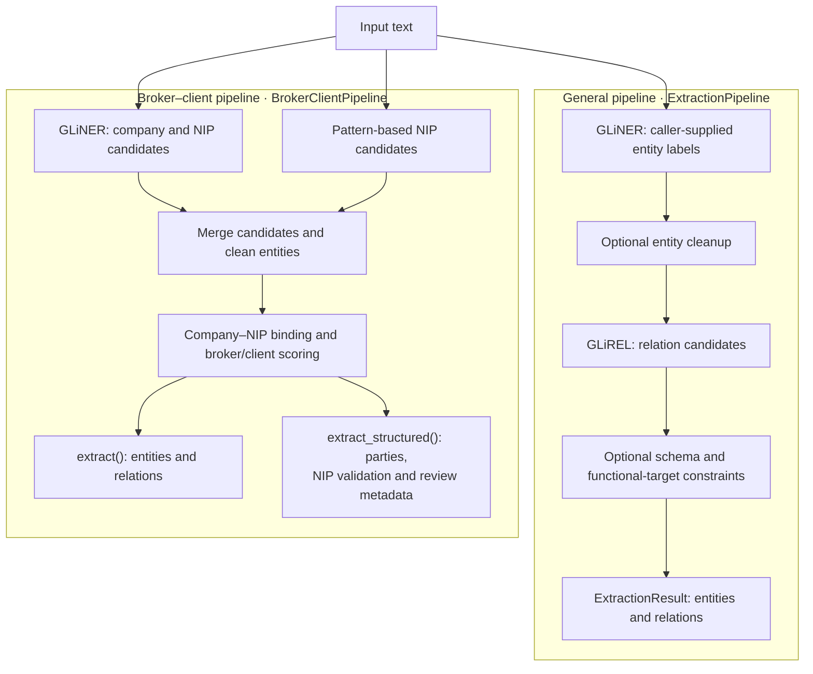

# Structured Information Extraction

**An applied NLP research project investigating zero-shot entity and relation extraction in Polish insurance and brokerage documents.**

This repository studies how pretrained **GLiNER** and **GLiREL** models can be adapted to a concrete document understanding task without domain-specific model fine-tuning: identifying companies, extracting business identifiers, and determining which company acts as an insurance broker and which as its client.

The experiments compare raw neural extraction, extraction with schema constraints and deterministic cleanup, and a specialized hybrid pipeline that combines neural entity detection with rules for company–NIP association and broker–client role assignment. The aim is to understand where generalist models are useful and where explicit domain knowledge improves their outputs.

## Research problem

In a Polish brokerage authorization (*pełnomocnictwo brokerskie*), detecting two company names is only part of the task. A useful structured representation must also determine:

- Which company is the **broker**, and which is the **client / principal** (*klient, mocodawca, ubezpieczający*)?
- Which **NIP** belongs to each company?
- How should prefixes, identifier formatting, and selected OCR-like errors be handled?
- Which outputs need additional review?

For example, given an illustrative passage:

> Mocodawca Alfa Logistyka Sp. z o.o. (NIP: 5250007738) upoważnia Kancelarię Brokerską Lex Sp. z o.o. (NIP: 5260251049).

The target representation includes two parties and three directed relations:

```text
Alfa Logistyka Sp. z o.o.          → client
Kancelarię Brokerską Lex Sp. z o.o. → broker

(client) --has NIP--> 5250007738
(broker) --has NIP--> 5260251049
(broker) --broker for--> (client)
```

The names and identifiers in this example illustrate the extraction schema; their pairing does not assert real company identities. Extracted names retain the wording used in the input, including Polish inflection.

## Research questions and approach

1. **How well do pretrained models transfer to this domain?** Use GLiNER for entity mentions and GLiREL for directed relation predictions with labels supplied at inference time.
2. **How much does deterministic post-processing help?** Compare raw predictions with cleaned identifier spans and schema-constrained relations on the same generic business dataset.
3. **Can role resolution be separated from entity detection?** Detect `company` and `NIP` first, then assign broker/client roles and company–NIP links using local context and document structure.
4. **What happens under selected input defects?** Examine formatted identifiers, OCR-like label errors, registration blocks, missing parties, and invalid NIP checksums.

Here, *zero-shot* means using the pretrained checkpoints without training them on this repository's task data. The specialized pipeline still contains manually designed domain rules. It is therefore a hybrid research prototype, and its full behavior depends on both the model and those rules.

## Architecture



### General extraction pipeline

[`ExtractionPipeline`](src/structured_ie/pipeline/extraction_pipeline.py) combines GLiNER and GLiREL, with optional entity cleanup and relation filtering. Entity and relation labels are supplied by the caller. An alignment layer converts character offsets into the token spans expected by GLiREL.

The default business schema covers `has NIP`, `has REGON`, `broker for`, and `works for`. It filters invalid endpoint types and, for identifiers, keeps the highest-scoring source when several companies claim the same target.

### Broker–client pipeline

[`BrokerClientPipeline`](src/structured_ie/pipeline/broker_client_pipeline.py) uses GLiNER for `company` and `NIP`, supplements identifier candidates with regex detection, and cleans the resulting entities. It then uses a deterministic resolver instead of GLiREL:

- Company–NIP binding uses parentheses, registration clauses, and a nearest-candidate fallback.
- Role assignment scores company names and local phrases such as *mocodawca*, *udziela pełnomocnictwa*, and *broker ubezpieczeniowy*.
- `extract_structured()` adds NIP checksum results and review reasons for selected ambiguous or incomplete outputs.

Model inference runs locally on CPU or CUDA after the pretrained weights have been downloaded. No hosted inference API is used by these pipelines.

## Experimental results

The repository contains two small synthetic datasets of 20 examples each and six constructed stress scenarios. The results below describe these local experiments; they do not establish performance on an independent collection of real contracts.

| Configuration | Dataset | Matching | Entity F1 | Relation F1 | Evidence |
| :--- | :--- | :--- | ---: | ---: | :--- |
| GLiNER + GLiREL, raw predictions | Generic business, 20 examples | Exact | 41.13% | 10.53% | Historical experiment log |
| GLiNER + GLiREL, cleanup and constraints | Generic business, 20 examples | Exact | 91.47% | 50.70% | Historical experiment log |
| GLiNER + GLiREL, cleanup and constraints | Generic business, 20 examples | Relaxed | 97.67% | 70.42% | Committed JSON report |
| GLiNER + broker–client resolver | Broker–client, 20 examples | Exact | 100.00% | 100.00% | Committed JSON report |

**Interpretation:** the generic experiments suggest that span cleanup and relation constraints can substantially improve the observed baseline. The specialized resolver matches all annotated outputs on its 20 examples. Because it uses a different dataset and a narrower output schema, its score is not a direct model-to-model improvement over the generic pipeline.

`exact` compares case-normalized text and labels, not character offsets. `relaxed` accepts substring matches and, for entities, span overlap. See [experiments and evaluation methodology](docs/experiments.md) for precision/recall, report provenance, stress scenarios, and threats to validity.

## Quick start

Requires Python 3.11 or later. From the repository root:

```bash
python3.11 -m venv .venv
source .venv/bin/activate
python -m pip install -e ".[dev]"
```

Default checkpoints are `urchade/gliner_multi-v2.1` and `jackboyla/glirel-large-v0`. Initial model loading requires access to Hugging Face unless weights are already cached.

### Extract broker and client

```python
import json

from structured_ie.pipeline.broker_client_pipeline import BrokerClientPipeline

pipeline = BrokerClientPipeline.from_pretrained()
text = (
    "Mocodawca Alfa Logistyka Sp. z o.o. (NIP: 5250007738) upoważnia "
    "Kancelarię Brokerską Lex Sp. z o.o. (NIP: 5260251049)."
)

result = pipeline.extract_structured(text)
print(json.dumps(result.to_dict(), ensure_ascii=False, indent=2))
```

The structured result contains optional `broker` and `client` objects with names, NIPs, character spans, entity scores, raw identifier text, and checksum status. Top-level fields are `confidence`, `needs_review`, and `review_reasons`. The current `confidence` value is a rule-based status indicator, not a calibrated probability of correctness.

Use `pipeline.extract(text)` for the shared `ExtractionResult` representation with `entities` and `relations`. Review metadata belongs to `extract_structured()`.

### Extract with custom labels

```python
from structured_ie.pipeline.extraction_pipeline import ExtractionPipeline

pipeline = ExtractionPipeline.from_pretrained(enable_postprocessing=True)
result = pipeline.extract(
    text="Alfa Logistyka S.A. o numerze NIP 5250007738 zatrudnia Jana Kowalskiego.",
    entity_labels=["company", "person", "NIP"],
    relation_labels=["has NIP", "works for"],
    entity_threshold=0.4,
    relation_threshold=0.3,
)
print(result.to_dict())
```

Custom relations may need corresponding constraints in an `ExtractionSchema`; unknown relation names are not constrained by the default schema.

## Run experiments and examples

Run commands from the repository root. These commands perform model inference; outputs can vary with checkpoint and dependency versions.

```bash
# Raw generic baseline
python examples/run_evaluation.py --dataset data/synthetic_cases.json --pipeline standard --no-postprocess --match-mode exact --output data/reproduced_baseline.json

# Generic pipeline with cleanup and constraints
python examples/run_evaluation.py --dataset data/synthetic_cases.json --pipeline standard --postprocess --match-mode exact --output data/reproduced_generic_exact.json

# Specialized broker–client pipeline
python examples/run_evaluation.py --dataset data/broker_client_cases.json --pipeline broker_client --match-mode exact --output data/reproduced_broker_client.json

# Three illustrative extraction examples
python examples/broker_client_example.py
```

For an interactive walkthrough, open [`demo_broker_client_ie.ipynb`](notebooks/demo_broker_client_ie.ipynb). The notebook additionally needs `pandas` and a notebook frontend, such as JupyterLab:

```bash
python -m pip install pandas jupyterlab
jupyter lab notebooks/demo_broker_client_ie.ipynb
```

## Repository guide

```text
structured-information-extraction/
├── README.md
├── pyproject.toml                 # Package metadata and dependencies
├── docs/                          # Technical overview and experiment methodology
├── data/                          # Synthetic datasets, stress cases, saved reports
├── examples/                      # Inference demos and benchmark CLI
├── notebooks/                     # Interactive broker–client walkthrough
├── src/structured_ie/
│   ├── config.py                  # Model names, thresholds, and device defaults
│   ├── ner/                       # NER interface and GLiNER wrapper
│   ├── relations/                 # Relation extraction interface and GLiREL wrapper
│   ├── pipeline/                  # Extraction flows and span/token alignment
│   ├── postprocessing/            # Cleanup, relation constraints, role resolution
│   ├── normalization/             # Text utilities and identifier validation
│   ├── schemas/                   # Typed outputs and relation schema definitions
│   └── evaluation/                # Dataset loading, metrics, and evaluator
└── tests/                         # Component tests with mocked model calls
```

The [technical overview](docs/project-overview.md) explains implementation choices. The [experiment log](docs/experiments.md) documents the evidence and open research questions.

## Scope and limitations

- Input is already extracted text. PDF parsing, OCR execution, page layout analysis, and long-document chunking are outside the current implementation.
- The broker–client resolver assigns roles among the first two company candidates. It does not solve general multi-party contracts, and it can assign roles even when contextual evidence is weak.
- Local rules can fail on unfamiliar phrasing, repeated company mentions, or competing identifiers. NIP checksum validity does not establish that a number belongs to the extracted company.
- OCR support covers selected identifier patterns. The line-break joining utility is available separately and is not automatically called by the pipelines.
- Normalized identifier text can differ from its source slice. Character spans, particularly for formatted identifiers, need separate evaluation.
- The datasets are small and were used during development. No independent held-out real-document evaluation, confidence calibration, or controlled latency benchmark is provided.

## Further research

Priorities are an independently annotated corpus with a fixed test split; comparisons with supervised Polish encoders and generative extraction; isolated ablations for each rule component; robust multi-party resolution; and long-document processing with explicit source provenance.

New NER or relation models can be integrated through `BaseNERExtractor` and `BaseRelationExtractor` and evaluated using `PipelineEvaluator`.

## Development

```bash
pytest -v
ruff check .
ruff format --check .
```

Component tests and full model benchmarks answer different questions: mocked-model tests check pipeline behavior, while the evaluation scripts measure predictions from pretrained models.

## License

Licensed under the [Apache License, Version 2.0](LICENSE).
