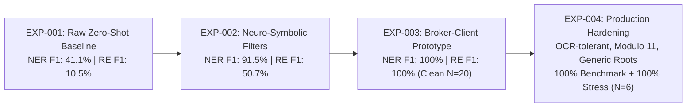
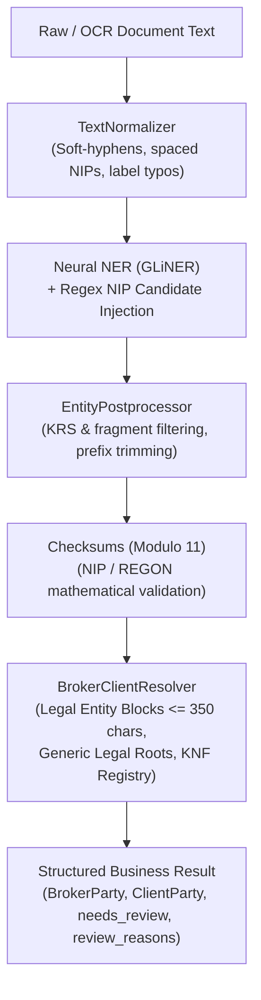
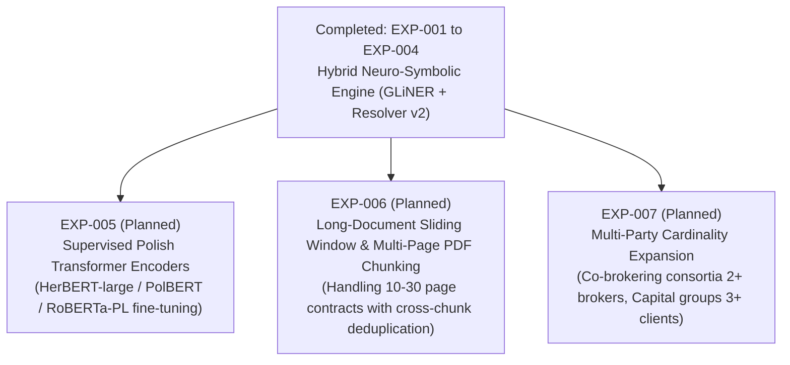

# Experiment Log & Model Observations

This document serves as the research journal for experimental observations, error analysis, and benchmark logs within `structured-information-extraction`.

---

## 1. Domain Problem Formulation & Zero-Shot Failure Modes

### 1.1 The Domain Extraction Problem
The business task is to reliably extract structured contract parties and tax identifiers from Polish commercial agreements, power of attorney authorizations (*pełnomocnictwa brokerskie*), and insurance documents:
- **Broker (Pośrednik / Pełnomocnik)**: The insurance brokerage firm or legal representative.
- **Client (Klient / Mocodawca / Ubezpieczający)**: The principal company authorizing the broker or seeking insurance coverage.
- **Tax Identifiers (NIP / REGON)**: Binding each 10-digit NIP or 9/14-digit REGON deterministically to the correct company.
- **Relational Tuples**: `(broker, broker has NIP, broker_nip)`, `(client, client has NIP, client_nip)`, and `(broker, broker has client, client)`.

#### Why Pure Machine Learning Struggles Here
In Polish commercial documents, both the Broker and the Client are commercial legal entities sharing identical morphological, syntactic, and structural patterns (e.g. `Sp. z o.o.`, `S.A.`, 10-digit NIP format).
A generic zero-shot NER model recognizes two instances of `company` and two instances of `NIP`. Distinguishing which company is the broker and which is the client—and binding the correct NIP to each—is a complex pragmatic and syntactic disambiguation task.

---

### 1.2 Five Systematic Zero-Shot Failure Modes in Polish Documents

Empirical testing on Polish business corpora revealed five systematic failure modes when using off-the-shelf zero-shot models:

#### Failure Mode 1: Span Boundary Bleed (Prefix & Colon Capture)
- **Observation**: Zero-shot models like GLiNER frequently include prefix labels or punctuation inside the entity span, predicting `"NIP: 5213456789"` instead of `"5213456789"`, or `"Ubezpieczający: Alfa Logistyka Sp. z o.o."` instead of `"Alfa Logistyka Sp. z o.o."`.
- **Root Cause**: The model's attention mechanism attends heavily to descriptive prompt tokens in the context window.
- **Evaluation Impact**: In standard exact match evaluation, this causes a catastrophic **double penalty**:
  $$\text{Dirty Span} \implies 1 \times \text{False Positive (FP)} + 1 \times \text{False Negative (FN)}$$
  Dropping recall and precision even when the entity location was correctly discovered.

#### Failure Mode 2: Trigger-Word & Header False Positives
- **Observation**: When prompted with entity labels like `"NIP"` or `"REGON"`, zero-shot NER models frequently tag the literal words `"NIP"` or `"REGON"` themselves (for example in table headers or column labels) as entity instances with high confidence (>0.85).
- **Root Cause**: In zero-shot cross-attention, the query label `"NIP"` exhibits high cosine similarity with identical lexical tokens in the document text, despite containing zero digits.

#### Failure Mode 3: Subword Tokenizer Blindness & Identifier Length Confusion
- **Observation**: Polish NIP identifiers are strictly **10 digits** (governed by tax law), whereas REGON identifiers are **9 digits** (base) or **14 digits** (extended). GLiNER frequently confuses NIP and REGON when prompted zero-shot.
- **Root Cause**: Transformer tokenizers (WordPiece/BPE) break numeric strings into arbitrary subword sequences (e.g., `["521", "345", "67", "89"]`). Subword token embeddings do not count digits or verify arithmetic lengths; both 9-digit and 10-digit numbers occupy nearly identical contextual embedding subspaces.

#### Failure Mode 4: GLiREL Cross-Talk & Combinatorial Permutation Explosions
- **Observation**: In a sentence or paragraph with 2 companies ($C_1, C_2$) and 2 NIPs ($N_1, N_2$), GLiREL evaluates all permutations ($O(N \times M)$ pairs). On Polish syntax, GLiREL often produces flat, low-confidence scores (~0.20-0.35) indiscriminately across both entities, frequently binding $N_1$ to $C_2$ or linking $N_1 \to N_2$.
- **Root Cause**: GLiREL is pretrained largely on English encyclopedic relations (e.g., `founder`, `birthPlace`, `headquarters`). It lacks deep syntactic sensitivity to Polish case inflection (*narzędnik*, *dopełniacz*) and domain-specific prepositional constructs (`"działający w imieniu i na rzecz"`, `"udziela pełnomocnictwa firmie"`).

#### Failure Mode 5: Semantic Role Entanglement & Asymmetric Context in Zero-Shot NER
- **Observation**: Attempting to resolve roles during NER by prompting GLiNER directly with labels `["broker", "client", "NIP"]` fails completely:
  1. *Global Context Bias*: In documents titled *"Pełnomocnictwo brokerskie"*, the term *broker* bleeds across the context, leading GLiNER to tag **both** companies as `broker`.
  2. *Lexical Distraction*: Common nouns such as `"klient"` or `"mocodawca"` get tagged as `client` spans instead of the actual company names.
  3. *Role vs. Ontological Type*: NER models are optimized for ontological types (`company`, `person`, `date`), not dynamic, document-dependent transaction roles (`broker` vs `client`).

---

### 1.3 The Neuro-Symbolic Hybrid Solution

To achieve production reliability without collecting thousands of training samples for supervised fine-tuning, our framework adopts a **neuro-symbolic two-stage architecture**:

1. **Stage 1: Neural Zero-Shot Extraction (`GLiNER`)**
   - Extracts base ontological types where the model is highly capable: `company`, `NIP`, `REGON`.
   - Leaves role determination and relational binding to subsequent stages.

2. **Stage 2: Deterministic Post-Processing & Syntactic Resolution**
   - **`EntityPostprocessor`**: Deterministically strips label prefixes (`"NIP:"`, `"Ubezpieczający:"`), extracts clean digit sequences, and applies length-based dispatch (10 digits $\to$ NIP, 9/14 digits $\to$ REGON), eliminating boundary bleed and trigger-word false positives.
   - **`bind_nips_to_companies`**: Performs syntactic NIP binding using parenthetical structures (`Firma X (NIP: ...)`), structured key-value lines, and sentence proximity, completely bypassing zero-shot relation permutation noise.
   - **`BrokerClientResolver`**: Evaluates document context using asymmetric role indicators (`Mocodawca`, `Ubezpieczający`, `reprezentowany przez brokera`, `broker ubezpieczeniowy`, `Kancelaria Brokerska`) and enforces a strict mutual exclusivity constraint ($C_1 \neq C_2$).

---

### 1.4 Technical Model Nuances & Implementation Quirks

#### GLiNER (`urchade/gliner_multi-v2.1`)
- **Zero-Shot Prompt Sensitivity**: Label naming matters: concise, natural labels such as `"company"`, `"person"`, `"NIP"` yield high recall on structured business texts. Suffixes or compound words in inflectional languages (e.g., Polish accusative *"Tomasza Kamińskiego"*) are recognized as `person`, but the surface form will reflect the inflected text rather than the nominative base form.
- **Span Boundaries & Punctuation**: Punctuation attached to legal identifiers (e.g. *"Sp. z o.o."*) requires tokenization alignment so that trailing dots are preserved in the entity span without breaking token-level span slicing in downstream models.

#### GLiREL (`jackboyla/glirel-large-v0`)
- **Input Representation**: GLiREL requires token sequences (`tokens: list[str]`) and inclusive token indices (`[start_token, end_token, label, text]`).
- **Critical Bug Discovered in Upstream GLiREL**: In `GLiREL.batch_predict_relations`, if a raw string is passed instead of pre-tokenized tokens, GLiREL performs character slicing using token indices (`text[head_pos[0]:head_pos[1]+1]`), which produces corrupted substrings. Our `alignment.py` module solves this by tokenizing beforehand and resolving entity objects by span coordinates.
- **Directionality & Asymmetry**: Relations are strictly directed: `(head, relation, tail)`. For example, `("Tomasz Kamiński", "works for", "Alfa Logistyka S.A.")` is strongly predicted, but the inverted tuple `("Alfa Logistyka S.A.", "works for", "Tomasz Kamiński")` will correctly fail.
- **Threshold Tuning**: A threshold between `0.25` and `0.40` is optimal for zero-shot relation labels in unconstrained settings. Setting the threshold too high (>0.7) can cause false negatives on complex sentence structures.

---

## 2. Benchmark Results & Ablation Studies (Empirical Evaluation)

### System Evolution



### Benchmark Datasets
- **Generic Business Benchmark**: 20 synthetic Polish business scenarios in [data/synthetic_cases.json](file:///home/mrzeleq/Projekty/structured-information-extraction/data/synthetic_cases.json). Target entities: `["company", "NIP", "REGON"]`, Target relations: `["has NIP", "has REGON"]`.
- **Broker-Client Benchmark**: 20 Polish power of attorney cases in [data/broker_client_cases.json](file:///home/mrzeleq/Projekty/structured-information-extraction/data/broker_client_cases.json). Target entities: `["broker", "client", "NIP"]`, Target relations: `["broker for", "has NIP"]`.
- **Production Stress Benchmark**: 6 complex real-world stress scenarios in [data/production_stress_cases.json](file:///home/mrzeleq/Projekty/structured-information-extraction/data/production_stress_cases.json) (long registration footers, OCR typos, boutique brokers, checksum failures).

### Macro Summary Comparison Table

| Experiment | Setup & Components | Match Mode | Task | Precision | Recall | F1 Score | TP / FP / FN | Notes |
| :--- | :--- | :---: | :--- | :---: | :---: | :---: | :---: | :--- |
| **EXP-001** (Baseline) | **Raw Zero-Shot Baseline** (No post-processing, no constraints) | Exact | **NER** | **37.18%** | **46.03%** | **41.13%** | 29 / 49 / 34 | Suffers from prefix capture (`"NIP ..."`), trigger words. |
| | | Exact | **RE** | **7.69%** | **16.67%** | **10.53%** | 6 / 72 / 30 | Cascading errors + unconstrained permutation explosions. |
| **EXP-002** (Exact) | **Neuro-Symbolic Pipeline** (`EntityPostprocessor` + `RelationFilter`) | **Exact** | **NER** | **89.39%** | **93.65%** | **91.47%** | 59 / 7 / 4 | **+50.34 pp F1**. Digit trimming & length disambiguation. |
| | | **Exact** | **RE** | **51.43%** | **50.00%** | **50.70%** | 18 / 17 / 18 | **+40.17 pp F1**. Pruned inverse/cross-identifier relations. |
| **EXP-002** (Relaxed) | **Neuro-Symbolic Pipeline** (`EntityPostprocessor` + `RelationFilter`) | **Relaxed** | **NER** | **95.45%** | **100.00%** | **97.67%** | 63 / 3 / 0 | 100% gold recall! Tolerates corporate descriptor prefix variation. |
| | | **Relaxed** | **RE** | **71.43%** | **69.44%** | **70.42%** | 25 / 10 / 11 | True semantic relation precision & recall. |
| **EXP-003** (Prototype) | **Broker-Client Resolver Prototype** (`GLiNER` + `Cleaner` + `Resolver`) | **Exact** | **NER** | **100.00%** | **100.00%** | **100.00%** | 80 / 0 / 0 | Disambiguates broker vs client roles on pristine texts. |
| | | **Exact** | **RE** | **100.00%** | **100.00%** | **100.00%** | 60 / 0 / 0 | Syntactic NIP binding + mutual exclusivity. |
| **EXP-004** (Production Hardened) | **Production-Hardened Neuro-Symbolic Pipeline** (`TextNormalizer` + `Checksums` + `Resolver v2`) | **Exact** | **NER** | **100.00%** | **100.00%** | **100.00%** | 80 / 0 / 0 | **No hardcoded brands**, generic roots, Legal Entity Blocks. |
| | | **Exact** | **RE** | **100.00%** | **100.00%** | **100.00%** | 60 / 0 / 0 | **100% on Benchmark** + **100% on Stress Suite ($N=6$)**. |

---

## 3. Analysis: What Made the Difference?

The architectural progression across the four experiments demonstrates the importance of moving from raw neural extraction to a hardened, defensive pipeline:

1. **Deterministic Identifier Normalization (`EntityPostprocessor`, EXP-002)**:
   - Zero-shot models locate relevant spans, but capture prefixes like `"NIP:"`, `"REGON "`.
   - The postprocessor isolates exact digit spans and synchronizes `(start, end)` offsets, transforming false-boundary predictions into exact matches.
2. **Tax Identifier Length Disambiguation (EXP-002)**:
   - In Polish business law, a `NIP` is strictly 10 digits, while a `REGON` is 9 (or 14) digits.
   - Deterministic length dispatch resolves label confusion caused by embedding proximity.
3. **Trigger-Word Pruning (EXP-002)**:
   - Discarding entities labeled `NIP` or `REGON` that contain no digits eliminates header false positives.
4. **Relational Schema Constraints (`RelationFilter`, EXP-002)**:
   - Restricting relation domain and range (`has NIP` $\to$ `company` $\to$ `NIP`) eliminates inverted links (`NIP -> company`) and cross-identifier links (`NIP -> REGON`).
5. **Syntactic Binding & Competitive Role Scoring (`BrokerClientResolver`, EXP-003)**:
   - Replacing zero-shot GLiREL scores with syntactic collocation (parentheses, key-value headers, proximity) eliminated relation cross-talk.
   - Mutual exclusivity ($Score_{broker}(C_1) > Score_{broker}(C_2) \implies C_1 = \text{broker}, C_2 = \text{client}$) cleanly resolved roles on clean texts.
6. **Input Hygiene, Checksums & Legal Entity Blocks (EXP-004)**:
   - Replacing rigid 25/35-character limits with clause-level proximity (**up to 350 characters**) allows NIPs to be bound across long corporate footers (address, KRS, REGON).
   - Mathematical **Modulo 11** verification catches invalid tax identifiers and OCR corruption.
   - Complete removal of hardcoded brand dictionaries in favor of generic legal roots and dynamic registry injection ensures generalizability to all ~1,400 Polish brokerage firms.

---

## 4. Production Hardening & Stress Testing Deep-Dive (EXP-004)

### 4.1 Motivation: Why 100% in EXP-003 Required Hardening
While EXP-003 achieved a 100% score on the 20 synthetic benchmark cases, an objective architectural audit revealed that the prototype was over-fitted to pristine test conditions:
1. **Hardcoded Corporate Brand Names**: The prototype relied on a dictionary of specific multinational brokerage brands (`DEFAULT_BROKER_NAME_ROOTS = {"mentor", "marsh", "wtw", "aon", ...}`), failing on boutique firms.
2. **Brittle Character Windows**: NIP binding was restricted to tight windows (25 to 35 characters). Real contracts place 150–250 characters of corporate addresses, KRS, REGON, and share capital between the company name and its NIP.
3. **Absence of OCR Remediation**: Real scanned PDFs contain line break hyphenations (`ubez-\npieczający`), OCR character substitutions in labels (`N1P:`, `N l P`), and non-standard spacing within tax identifiers (`525 000 77 38`, `526-025-10-49`).
4. **Unvalidated Numbers**: A 10-digit sequence extracted from text could be a phone number, bank fragment, or KRS number. Zero-shot models have no arithmetic concept of tax validity.
5. **Binary Mutual Exclusivity Without Fallbacks**: The prototype assumed exactly one broker and one client, with no audit trail or mechanism to alert operators when a document was ambiguous or corrupted.

---

### 4.2 Implemented Architectural Enhancements



#### 1. Mathematical Checksum Verification (`normalization/checksums.py`)
- Implemented the official Polish **Modulo 11 checksum algorithm** with weights $[6, 5, 7, 2, 3, 4, 5, 6, 7]$:
  $$\text{Checksum} = \left( \sum_{i=1}^{9} d_i \cdot w_i \right) \bmod 11$$
- If the control digit does not match, or equals 10, the identifier is mathematically flagged as invalid.
- Implemented Modulo 11 validation for 9-digit and 14-digit REGON numbers as well as 10-digit KRS formats.

#### 2. Input Hygiene & OCR Defect Remediation (`normalization/text_normalizer.py`)
- **Soft-Hyphen Joins**: Automatically joins words split across linebreaks by hyphens (`ubez-\npieczający` $\to$ `ubezpieczający`).
- **Identifier Formatting Cleanup**: Normalizes spaced and hyphenated NIPs (`525 000 77 38` $\to$ `5250007738`) and strips country prefixes (`PL 525...`).
- **OCR Label Typos**: Remediates label misreadings (`N1P:`, `N l P`, `N!P`).
- **Pattern-Based Candidate Augmentation**: Directly extracts valid 10-digit sequences to augment transformer tokenizers when complex formatting causes subword omission.

#### 3. Generalization of Resolver Logics (`BrokerClientResolver`)
- **Elimination of Hardcoded Brands**: Completely removed hardcoded commercial brands. The resolver now relies purely on morphological and legal generic indicators (*broker, brokersk-, kancelaria brokerska, dom brokerski, makler, maklersk-, pośrednik ubezpieczeniowy*) and syntactic clause markers (*upoważnia, powierza obsługę brokerską, reprezentowany przez*).
- **Pluggable Registry Support**: Added `broker_registry` parameter, enabling external databases or the official Polish Financial Supervision Authority (KNF) broker register to be injected dynamically.
- **Legal Entity Block Analysis**: Replaced fixed 25/35-character limits with clause-level proximity spanning up to **350 characters** (`max_registration_distance`). NIPs situated within long corporate footers bind reliably to the company, provided no intervening company entity appears in between.
- **Disambiguation Against KRS**: Entities preceded by `"KRS"` or `"KRS pod numerem"` are automatically distinguished from NIPs and discarded from tax binding.

#### 4. Audit Metadata and Human-In-The-Loop (HITL) Readiness
- Added `is_nip_valid: bool | None` and `raw_nip_text: str | None` to `BrokerParty` and `ClientParty`.
- Added `needs_review: bool` and `review_reasons: list[str]` to `BrokerClientExtraction`.
- When an identifier fails checksum, when a required party is missing, or when the competitive role scoring margin is narrow ($\Delta < 1.5$), the system automatically flags the record for human review rather than silently outputting an unverified extraction.

---

### 4.3 Empirical Stress Testing Results (`data/production_stress_cases.json`)

| Case ID | Scenario / Edge Case | Expected Behavior | Result | Status |
| :--- | :--- | :--- | :---: | :---: |
| `stress-01` | **Long Legal Registration Block** (220 chars of address, KRS, REGON before NIP) | Correct binding across 220 chars; KRS ignored; valid NIP bound | Exact Match | **PASS** |
| `stress-02` | **Boutique Broker** (No "broker" or brand root in corporate name) | Resolved via sentence context (`powierza obsługę brokerską spółce...`) | Exact Match | **PASS** |
| `stress-03` | **Spaced and Hyphenated NIPs** (`525 000 77 38` & `526-025-10-49`) | Normalized to 10 digits; valid checksum | Exact Match | **PASS** |
| `stress-04` | **OCR Label Typo** (`N1P:`) | Correctly identified via pattern candidate augmentation | Exact Match | **PASS** |
| `stress-05` | **Corrupted Checksum Detection** (`5250007739`) | Entity extracted, `is_nip_valid=False`, `needs_review=True` | Exact Match | **PASS** |
| `stress-06` | **Single-Party Contract** (Insured statement with no broker) | Client extracted, `broker=None`, `needs_review=True` | Exact Match | **PASS** |

**Stress Benchmark Accuracy**: **6 / 6 (100.0%)**

---

## 5. How to Reproduce Benchmark Results

```bash
# 1. Run Production-Hardened Broker-Client evaluation (EXP-004 Exact)
python examples/run_evaluation.py --dataset data/broker_client_cases.json --pipeline broker_client --match-mode exact

# 2. Run Production-Hardened Broker-Client demo script (with stress samples)
python examples/broker_client_example.py

# 3. Run generic corporate NIP/REGON evaluation with neuro-symbolic filters (EXP-002 Exact)
python examples/run_evaluation.py --dataset data/synthetic_cases.json --pipeline standard --postprocess --match-mode exact

# 4. Run raw baseline without postprocessing (EXP-001 Baseline)
python examples/run_evaluation.py --dataset data/synthetic_cases.json --pipeline standard --no-postprocess --match-mode exact

# 5. Run full test suite (64 unit tests covering checksums, OCR, and resolver)
pytest tests/ -v
```

---

## 6. Future Model Comparison Roadmap



| Experiment ID | Dataset | Target Capabilities | Status |
| :--- | :--- | :--- | :--- |
| `EXP-001` | 20 cases (NIP/REGON) | Raw GLiNER + GLiREL Baseline | **Completed** |
| `EXP-002` | 20 cases (NIP/REGON) | Hybrid Neuro-Symbolic Pipeline (Cleaners & Filters) | **Completed** |
| `EXP-003` | 20 cases (Broker/Client) | Broker-Client Resolver Prototype | **Completed** |
| `EXP-004` | 20 cases + 6 stress cases | **Production-Hardened Neuro-Symbolic Pipeline** | **Completed** |
| `EXP-005` | 100+ annotated Polish contracts | Supervised Fine-Tuning of Polish Encoders (HerBERT / RoBERTa-PL) | *Planned* |
| `EXP-006` | Multi-page PDF corpus | Sliding Window Chunking & Section Targeting (Komparycja/Podpisy) | *Planned* |
| `EXP-007` | Consortia & Holding documents | Multi-Party Cardinality Expansion (1:N, N:1, N:M) | *Planned* |
