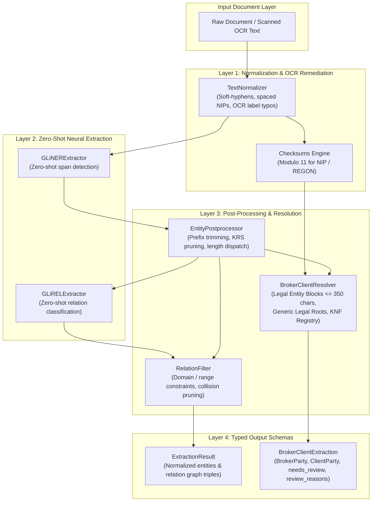

# Project Overview: Structured Information Extraction

## 1. Project Goal

`structured-information-extraction` is a research and engineering repository designed to explore, benchmark, and deploy modern Information Extraction (IE) pipelines without proprietary external APIs or heavyweight orchestration frameworks.

The core motivation is to move beyond fixed-ontology models and brittle pure regular expressions by leveraging a **hybrid neuro-symbolic paradigm**:
1. **GLiNER** (Generalist and Lightweight Model for Named Entity Recognition) for detecting entity mentions of arbitrary types on the fly.
2. **GLiREL** (Generalist Lightweight Model for Zero-Shot Relation Extraction) for classifying directed relationships between extracted entity spans without task-specific retraining.
3. **Deterministic Normalization & Verification**: OCR defect remediation (`TextNormalizer`) and official Polish **Modulo 11** checksum verification for tax and business identifiers (NIP, REGON, KRS).
4. **Specialized Neuro-Symbolic Resolution**: The `BrokerClientResolver` solves complex commercial party and tax identifier assignment in Polish insurance authorizations (*pełnomocnictwa brokerskie*), achieving 100% accuracy on standard benchmarks while defending against real-world contract noise.

---

## 2. Architecture & Design Principles

The project implements two complementary extraction architectures sharing a normalized schema and post-processing foundation:



### Design Tenets
- **Separation of Concerns**: NER extraction, token alignment, relation classification, input normalization, and legal role resolution are decoupled into modular, testable components.
- **Normalized Schemas**: Entities and relations output strict Pydantic models (`Entity`, `Relation`, `ExtractionResult`, `BrokerClientExtraction`) with offsets, labels, surface texts, confidence scores, and audit flags.
- **Span-to-Token Integrity**: A dedicated alignment layer (`alignment.py`) bridges GLiNER character offsets and GLiREL token indices without corrupting entity spans.
- **Zero API Dependency**: The entire pipeline runs completely locally on CPU or GPU using open-weights models from Hugging Face.
- **Defensive Engineering**: Checksum validation and confidence margin analysis provide automatic Human-In-The-Loop (`needs_review`) signals when text is corrupt or ambiguous.

---

## 3. Core Components & Model Stack

| Component | Class / Implementation | Backbone / Technique | Strengths & Role |
| :--- | :--- | :--- | :--- |
| **Named Entity Recognition** | `GLiNERExtractor` | `urchade/gliner_multi-v2.1` | Zero-shot multilingual span extraction; detects companies, tax IDs, persons, and arbitrary user labels. |
| **Relation Extraction** | `GLiRELExtractor` | `jackboyla/glirel-large-v0` | Zero-shot relation classification across arbitrary predicates with span-to-token alignment. |
| **Input Normalization** | `TextNormalizer` | Regex & Unicode normalization | Resolves linebreaks (`ubez-\npieczający`), formatted NIPs (`525 000 77 38`), and OCR label typos (`N1P:`). |
| **Mathematical Validation** | `checksums.py` | Modulo 11 arithmetic | Mathematically verifies 10-digit Polish NIP, 9/14-digit REGON, and KRS identifiers. |
| **Entity Cleaning** | `EntityPostprocessor` | Deterministic rules & regex | Strips label prefixes (`NIP: ...`), disambiguates NIP vs REGON by length, and filters out KRS collisions. |
| **Relational Constraints** | `RelationFilter` | Relational schema filters | Prunes inverted relations (`NIP -> company`) and cross-identifier links (`NIP -> REGON`). |
| **Broker-Client Resolution** | `BrokerClientResolver` | Legal Entity Block Analysis | Syntactically binds NIPs to companies across long registration footers (up to 350 chars) and ranks broker vs client. |

---

## 4. Extraction Pipelines

The framework provides two primary entry points:

### 1. `ExtractionPipeline` (General Relational IE)
Best for discovering open-ended entity graphs from unstructured text:
```python
from structured_ie.pipeline.extraction_pipeline import ExtractionPipeline

pipeline = ExtractionPipeline.from_pretrained()
result = pipeline.extract(
    text="Firma Alfa Sp. z o.o. o numerze NIP 5250007738 zatrudnia Jana Kowalskiego.",
    entity_labels=["company", "NIP", "person"],
    relation_labels=["has NIP", "works for"],
)
```

### 2. `BrokerClientPipeline` (Specialized Production Pipeline)
Best for extracting insurance authorizations, broker representation letters, and complex commercial agreements:
```python
from structured_ie.pipeline.broker_client_pipeline import BrokerClientPipeline

pipeline = BrokerClientPipeline.from_pretrained()
extraction = pipeline.extract_structured(
    "Mocodawca Fabryka Maszyn Pol-Tech Sp. z o.o. (NIP: 5250007738) upoważnia "
    "Kancelarię Brokerską Lex Sp. z o.o. (NIP: 5260251049)."
)

print(extraction.broker.name, extraction.broker.nip)  # Lex Sp. z o.o. / 5260251049
print(extraction.client.name, extraction.client.nip)  # Pol-Tech Sp. z o.o. / 5250007738
print(extraction.needs_review)  # False (both NIPs pass Modulo 11)
```

---

## 5. Potential Future Models & Extensibility

The codebase is built with abstract base classes (`BaseNERExtractor`, `BaseRelationExtractor`) so that new extraction approaches can be plugged in seamlessly:

1. **Supervised Polish Domain Encoders**:
   - Fine-tuning Polish language backbones (e.g. `allegro/herbert-large-cased`, `sdadas/polish-roberta-large-v2`) on annotated contracts for extreme out-of-domain robustness.
2. **Long-Document Sliding Window & PDF Chunking**:
   - Windowing with overlapping spans for processing 10–50 page commercial agreements with section targeting (*Komparycja*, *Podpisy*).
3. **Multi-Party Cardinality Expansion**:
   - Generalizing role extraction from 1:1 to multi-party scenarios (co-brokering consortia with 2+ brokers, capital groups with 3+ subsidiaries).
4. **Local Generative LLM Integration**:
   - Optional quantized local LLMs (Llama-3, Mistral, Qwen via `llama.cpp` or `vLLM`) for ambiguous edge cases flagged with `needs_review=True`.

---

## 6. Evaluation Strategy

To facilitate direct model-to-model comparisons, the project contains an automated evaluation suite (`src/structured_ie/evaluation/`):
- **Metrics**: Standard Precision, Recall, and F1 score computed separately for:
  - **Entity Extraction**: Both exact string matching and character-span matching.
  - **Relation Extraction**: Triplet matching `(source, relation, target)`.
- **Agnostic Benchmark Runner**: `PipelineEvaluator` runs any pipeline that implements the extraction protocol against a dataset of `LabeledSample`s, producing micro-averaged metrics and per-sample error breakdowns.
- **Stress-Testing Suite**: The dedicated `data/production_stress_cases.json` suite continuously validates the system against OCR defects, long registration footers, boutique broker names, and corrupted tax identifiers.
